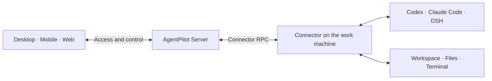

<p align="center">
  <strong>AgentPilot: an open-source agent workbench across your devices</strong><br>
  Connect your work machines. Manage AI agents from desktop, mobile and Web.
</p>

<p align="center">
  Open source · Multiple agents · Sessions and workspaces · Self-hosting
</p>

<p align="center">
  <a href="#downloads-and-access">Download</a> ·
  <a href="#self-hosting">Self-host and open Web</a> ·
  <a href="README.md">简体中文</a>
</p>

<p align="center">
  <a href="#license"></a>
  <a href="docker/README.md"></a>
</p>

**AgentPilot** is an open-source agent workbench across your devices. Connect a work machine running **Codex, Claude Code or DeepSeek Harness**, then view sessions, respond to requests, manage files and use terminals from desktop, mobile and Web. Agents execute tasks on the connected work machine.

## Downloads and access

Install the desktop client on your work machine, then access it from your phone, tablet or Web. Use the Connector CLI to connect Linux and headless servers. Each client connects to the service instance you deploy yourself.

| Platform | Get the client |
| --- | --- |
| **macOS** | [GitHub Releases · Universal DMG](https://github.com/lxfebd/AgentPilot/releases) |
| **Windows** | [GitHub Releases · x64 installer](https://github.com/lxfebd/AgentPilot/releases) |
| **Android** | [GitHub Releases · APK](https://github.com/lxfebd/AgentPilot/releases) |
| **iOS / iPadOS** | [App Store](https://apps.apple.com/cn/app/agent-pilot) · [TestFlight](https://testflight.apple.com/join/AgentPilot) |
| **Web** | Deploy your own service, then open its address (see [Self-hosting](#self-hosting)) |
| **Linux / headless** | [Run the Connector CLI](connector/README.md) |

> After the first official release, the installer links above will point to the corresponding GitHub Release. `main` is the current development branch, so new source fixes may not be included in the installers yet.

<details>
<summary>Platform requirements, installers and updates</summary>

- macOS: Universal for Apple Silicon / Intel; signed and notarized; requires macOS 12 or later.
- Windows: x64 desktop workbench with a managed Connector; the current installer is not code signed.
- Android: Android 8.0 or later.
- iOS / iPadOS: download from the App Store, or install the beta through TestFlight; beta availability is shown on the invitation page.
- Linux / headless: run the Connector on the work machine and control it from another client.

Each client and service releases PATCH versions independently, and database schema revisions are numbered separately.

</details>

## Agents and workspace management

| What you want to do | In AgentPilot |
| --- | --- |
| **Manage projects and sessions** | Switch between devices, projects and sessions, and follow progress through the timeline. |
| **Approve actions and answer requests** | Respond to tool approvals and input requests; interrupt or continue tasks by Runtime capability. |
| **View files and use terminals** | Browse and preview files, upload and download attachments, open remote shells and interactive terminals. |
| **Configure agents** | Configure Codex, Claude Code and DSH; pick models, permissions and actions according to each Runtime's capabilities. |

A Runtime is the component that runs and connects an Agent on the work machine. Model accounts and usage costs follow the rules of the Agent you use. Runtime capabilities differ; follow what the client shows. [DSH integration →](dsh-bridge-next/README.md)

## Desktop, mobile and Web

Use your phone to follow progress and answer an Agent, open your workspace on a tablet, and continue on your computer. Your own devices and sessions are accessible from any client under the same service and account.

**The phone controls; the work machine executes.** For remote use, keep the work machine on, online, and running the Connector and the corresponding Runtime.

## Getting started

1. **Sign in to a service.** Install a client or open Web, enter your service address and sign in.
2. **Connect a work machine.** Desktop bundles a managed Connector; servers and headless environments use the [Connector CLI](connector/README.md).
3. **Prepare agents and projects.** Configure the Runtime, account and working directory on the work machine, then create or open a session.
4. **Access from other devices.** Sign in to the same service and account from your phone, tablet or another computer to reach your devices and tasks.

## Where agents run and self-hosting

Agents use the work machine's workspace and permissions through the Connector. Deploy the service on your own server and enter that address in the client.



Session content, the timeline and uploaded attachments pass through or are stored on the Server where applicable. When self-hosting, the instance you deploy handles that server-side data.

<a id="self-hosting"></a>

### Deploy with Docker

Clone the repository and run the following command from the root, after replacing the example password and secret:

```bash
POSTGRES_PASSWORD=replace-with-a-strong-password \
AGENT_SERVER_SECRET=replace-with-a-long-random-secret \
docker compose -f docker/docker-compose.postgres.yml up --build
```

Open `http://127.0.0.1:5174` and use the setup token from the Server logs to complete the first admin setup. The Compose stack includes PostgreSQL, Redis, the migration job and a Server that hosts the Web client.

[Full deployment steps](docker/README.md) · [Server documentation](server/README.md)

## Development and contribution

The development environment uses **Python 3.12+ / uv / Node.js 22 / Corepack + Yarn**.

| To learn about | Start here |
| --- | --- |
| Agent connection and local execution | [Connector](connector/README.md) |
| Web and desktop clients | [Web source](web-next/) · [Desktop Workbench](desktop-workbench/README.md) |
| Native mobile clients | [Android](android/README.md) · [iOS source](ios/) |
| DSH integration | [DSH Bridge Next](dsh-bridge-next/README.md) |

Report issues through [Issues](https://github.com/lxfebd/AgentPilot/issues) and contribute through [Pull Requests](https://github.com/lxfebd/AgentPilot/pulls). When reporting, include the client version, OS, runtime type and reproduction steps, and remove credentials from logs.

## Community and feedback

Report issues through [Issues](https://github.com/lxfebd/AgentPilot/issues) and contribute through [Pull Requests](https://github.com/lxfebd/AgentPilot/pulls). If the project is useful to you, give it a [Star on GitHub](https://github.com/lxfebd/AgentPilot) to support it.

## License

MIT. The project's brand, download entry points and community are defined by this repository.

> **Acknowledgements**: AgentPilot is a rebranded fork of [Agents Anywhere](https://github.com/anywhere-labs/Agents-Anywhere) (MIT License). Thanks to the original authors for their open-source work.
