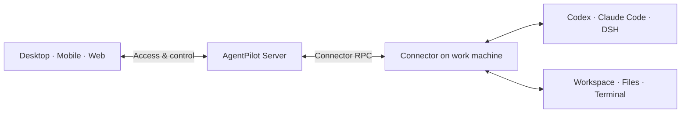

<p align="center">
  <a href="https://www.agent-pilot.com/en"></a>
</p>

<p align="center">
  <strong>Connect your work machines. Manage AI agents from desktop, mobile and Web.</strong><br>
  Open source · Multiple agents · Sessions and workspaces · Self-hosting
</p>

<p align="center">
  <a href="https://www.agent-pilot.com/en">Website</a> ·
  <a href="#downloads-and-access">Download</a> ·
  <a href="https://web.agent-pilot.com">Open Web</a> ·
  <a href="docs/README.md">Documentation</a> ·
  <a href="README.md">简体中文</a>
</p>

<p align="center">
  <a href="docs/releases/2.1.0.md"></a>
  <a href="#license"></a>
  <a href="docker/README.md"></a>
</p>

**AgentPilot** is an open-source agent workbench across your devices. Connect a work machine running **Codex, Claude Code or DeepSeek Harness**, then view sessions, respond to requests, manage files and use terminals from desktop, mobile and Web. Agents execute tasks on the connected work machine.

## Downloads and access

Install the desktop client on your work machine, then access it from your phone, tablet or Web. Use the Connector CLI to connect Linux and headless servers. Each client can connect to Cloud or a self-hosted service.

| Platform | Get the client |
| --- | --- |
| **macOS** | [GitHub Releases · Universal DMG](https://github.com/lxfebd/AgentPilot/releases) |
| **Windows** | [GitHub Releases · x64 installer](https://github.com/lxfebd/AgentPilot/releases) |
| **Android** | [GitHub Releases · APK](https://github.com/lxfebd/AgentPilot/releases) |
| **iOS / iPadOS** | [App Store](https://apps.apple.com/cn/app/agent-pilot) · [TestFlight](https://testflight.apple.com/join/AgentPilot) |
| **Web** | [Open Web](https://web.agent-pilot.com) |
| **Linux / headless** | [Run the Connector CLI](connector/README.md) |

> After the first official release, the installer links above will point to the corresponding GitHub Release. `main` is the current development branch, so new source fixes may not be included in the installers yet.

<details>
<summary>Platform requirements, installers and updates</summary>

- macOS: Universal for Apple Silicon / Intel; signed and notarized; requires macOS 12 or later.
- Windows: x64 desktop workbench with a managed Connector; the current installer is not code signed.
- Android: Android 8.0 or later.
- iOS / iPadOS: download from the App Store, or install the beta through TestFlight; beta availability is shown on the invitation page.
- Linux / headless: run the Connector on the work machine and control it from another client.

Each client and service releases PATCH versions independently, and database schema revisions are numbered separately; see the [versioning rules](docs/versioning.md). See the [2.1.0 release notes](docs/releases/2.1.0.md) for release scope.

</details>

## Agents and workspace management

<p align="center">
  
</p>

| What you want to do | In AgentPilot |
| --- | --- |
| **Manage projects and sessions** | Switch between devices, projects and sessions, and follow progress through the timeline. |
| **Approve actions and answer requests** | Respond to tool approvals and input requests; interrupt or continue tasks where the runtime supports it. |
| **Browse files and use terminals** | Preview and transfer files, and open a remote shell and interactive terminal. |
| **Configure agents** | Configure Codex, Claude Code and DSH; choose models, permissions and actions based on the capabilities each runtime supports. |

A Runtime is the component that runs and connects agents on the work machine. Model accounts and usage fees follow the rules of the agent you use. Runtimes differ in capabilities; what the client shows is authoritative. [Connect DSH →](dsh-bridge-next/README.md)

## Desktop, mobile and Web

<p align="center">
  
</p>

Check progress and answer your agent from your phone, open a workspace on your tablet, and continue on your computer. With the same service and account, your devices and sessions are reachable from any client.

**The phone controls; the work machine executes.** When working remotely, the work machine must stay on and online with the Connector and its runtimes running. The iPad above shows answering an agent's input request.

## First steps

1. **Sign in to a service.** Install a client or open Web, sign in to Cloud, or enter your self-hosted service address.
2. **Connect a work machine.** Desktop bundles a managed Connector; servers and headless environments use the [Connector CLI](connector/README.md).
3. **Prepare agents and projects.** Configure the runtime, account and working directory on the work machine, then create or open a session.
4. **Access from other devices.** Sign in to the same service and account from your phone, tablet or another computer to reach your devices and tasks.

See [installation and first use](docs/getting-started.md) for detailed pairing steps, sign-in troubleshooting and background operation.

## Where tasks run and self-hosting

Agents use the work machine's workspace and permissions through the Connector. Connect to Cloud, or deploy AgentPilot on your own server.



Session content, the timeline and uploaded attachments pass through or are stored on the Server as features require. When self-hosting, your deployed instance handles this server-side data.

### Deploy with Docker

Clone the repository and run the following from the root, after replacing the example password and secret:

```bash
POSTGRES_PASSWORD=replace-with-a-strong-password \
AGENT_SERVER_SECRET=replace-with-a-long-random-secret \
docker compose -f docker/docker-compose.postgres.yml up --build
```

Open `http://127.0.0.1:5174` and use the setup token from the Server log to set up the first administrator. The Compose stack includes PostgreSQL, Redis, a migration job and the Server hosting Web.

[Full deployment steps](docker/README.md) · [Backup and upgrade](docs/upgrading.md) · [Server documentation](server/README.md)

## Development and contributing

The development environment uses **Python 3.12+ / uv / Node.js 22 / Corepack + Yarn**. Start with the [development guide](docs/development.md) to run the source and the headless checks.

| To learn about | Start here |
| --- | --- |
| Overall architecture and API | [Server architecture](docs/server-architecture.md) · [API documentation](docs/api/README.md) |
| Agent connection and local execution | [Connector](connector/README.md) · [Runtime protocol](docs/runtime-protocol/README.md) |
| Web and desktop clients | [Web source](web-next/) · [Desktop Workbench](desktop-workbench/README.md) |
| Native mobile clients | [Android](android/README.md) · [iOS source](ios/) |
| DSH integration | [DSH Bridge Next](dsh-bridge-next/README.md) |
| More documentation | [Documentation index](docs/README.md) · [Protocol contracts](contracts/) |

Report issues through [Issues](https://github.com/lxfebd/AgentPilot/issues) or contribute through [Pull Requests](https://github.com/lxfebd/AgentPilot/pulls). When reporting, include the client version, OS, runtime type and reproduction steps, and remove credentials from logs.

## License

MIT. The project's brand, download entry points and community are defined by this repository.

> **Acknowledgements**: AgentPilot is a rebranded fork of [Agents Anywhere](https://github.com/anywhere-labs/Agents-Anywhere) (MIT License). Thanks to the original authors for their open-source work.

See [Image sources and reproduction](docs/readme-artwork/README.md) for the product screenshots and brand assets used in this README.
